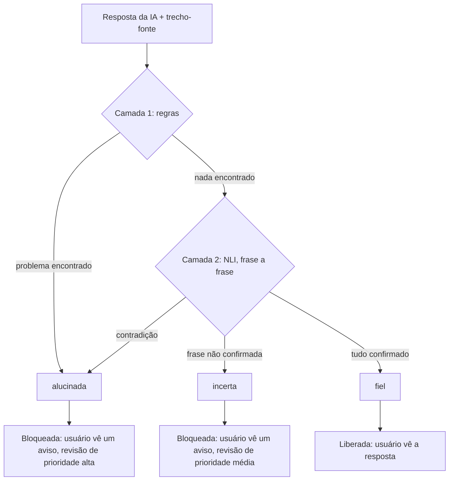
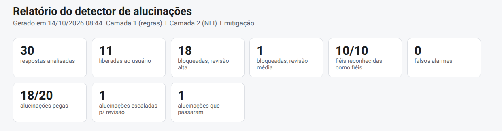

# ai-hallucination-detector


Pipeline em Python que **detecta alucinações** em respostas de IA sobre uma base de conhecimento. Para cada resposta, ele confere se o que foi dito é sustentado pelo trecho do documento usado como fonte e decide: **liberar** a resposta ao usuário ou **bloqueá-la** e encaminhar o caso para revisão humana.

> Projeto de portfólio sobre governança de IA. O [data-governance-validator](https://github.com/ewertonlna-cloud/data-governance-validator) cuida dos dados que **entram** no pipeline; este projeto cuida do que a IA **responde**.

## O problema

Modelos de linguagem escrevem frases fluentes mesmo quando não têm base para o que dizem. Num atendimento sobre políticas internas, uma resposta como "são 45 dias de férias", quando o documento diz 30, pode causar dano real. Este projeto trata a verificação como uma etapa de governança: nenhuma resposta chega ao usuário sem ser conferida contra a fonte.

## Como funciona



| Camada | O que faz | Característica |
|---|---|---|
| 1. Regras | Procura números, siglas e negações que aparecem na resposta e não existem na fonte | Roda na hora, sem IA, e cada alerta vem com o motivo escrito (auditável) |
| 2. NLI | Um modelo de linguagem julga cada frase da resposta: a fonte **sustenta**, **contradiz** ou **não menciona** | Mesma ideia da métrica de *faithfulness* usada em frameworks de avaliação de LLMs |

**Mitigação:** o projeto não tenta corrigir a resposta errada (corrigir texto automaticamente é arriscado). Se o detector não consegue confirmar a resposta, ela não chega ao usuário: no lugar vai um aviso ("Não consegui confirmar essa informação na base de conhecimento...") e o caso entra numa fila de revisão humana.

## Dataset de teste

A base de conhecimento é uma política de férias fictícia (5 seções). Para cada seção há uma pergunta e uma resposta correta, redigidas com apoio de IA e revisadas uma a uma contra o documento. Um gerador em código (não IA, para que cada rótulo seja confiável) cria as variações, sempre com **uma única alteração** por resposta alucinada:

| Tipo | Rótulo | O que muda |
|---|---|---|
| original | fiel | nada |
| paráfrase correta | fiel | troca por sinônimos, mantendo todos os fatos |
| troca numérica | alucinada | um número é trocado |
| troca de entidade | alucinada | um termo é trocado ("CLT" vira "regimento interno") |
| inversão de negação | alucinada | o sentido é invertido |
| fabricação | alucinada | uma frase inventada é adicionada |

Resultado: 30 respostas (10 fiéis e 20 alucinadas). A geração usa semente fixa, então rodar de novo produz exatamente o mesmo dataset.

## Resultados

| Configuração | Alucinações pegas | Passaram | Incertas | Falsos alarmes |
|---|---|---|---|---|
| Regras (Camada 1) | 16/20 | 4 | 0 | 0 |
| NLI sozinho (Camada 2) | 13/20 | 1 | 6 | 0 |
| **Regras + NLI** | **18/20** | **1** | **1** | **0** |

Em todas as configurações, as 10 respostas fiéis foram reconhecidas como fiéis. As camadas se complementam: as regras pegam o que o NLI considera apenas "não mencionado" (como valores inventados), e o NLI pega trocas de termo que as regras não enxergam.



## Decisões de projeto

- **Regras determinísticas antes da IA.** São baratas, instantâneas e explicáveis. O modelo só roda quando as regras não acham problema.
- **NLI frase a frase.** Decompor a resposta em afirmações e checar cada uma contra a fonte localiza melhor o problema do que julgar a resposta inteira.
- **Modelo multilíngue.** O primeiro modelo testado (`cross-encoder/nli-deberta-v3-small`) foi treinado só em inglês e errava em português sem avisar. O projeto usa `MoritzLaurer/mDeBERTa-v3-base-xnli-multilingual-nli-2mil7`.
- **`neutral` vira "incerta", não "alucinada".** "A fonte não menciona" mistura informação inventada, conversa social ("Claro, posso ajudar!") e fato verdadeiro fora da base. O modelo não distingue esses casos, e com 30 exemplos qualquer limite de confiança seria um chute. Então o caso vai para revisão humana.
- **Bloquear em vez de corrigir.** A resposta não confirmada nunca chega ao usuário.
- **Testes sem o modelo.** O modelo é trocado por uma versão falsa nos testes, então o CI roda em segundos e instala só o pytest.

## Limitações conhecidas

- O dataset é pequeno e foi criado pelo próprio projeto: os números ilustram o comportamento, mas não provam desempenho com respostas reais de IA.
- Trocas pequenas dentro de frases longas passam despercebidas. Exemplo: "conforme a CLT" trocado por "conforme o regimento interno" é aprovado, porque o resto da frase está correto.
- Informação inventada **sem** número, sigla ou negação cai em "incerta" (revisão humana), em vez de ser bloqueada como alucinação.
- Nas fabricações, as regras só pegam o que tem número: o NLI sozinho as classificou como "não mencionadas".
- O modelo NLI tem dificuldade com paráfrases muito reescritas em português. As paráfrases do dataset são leves (troca de sinônimos), então esse caso ainda não foi testado a fundo.
- As regras da Camada 1 são heurísticas simples e não entendem o sentido da frase. Valores como "R$ 1.500" são lidos como dois números ("1" e "500"), o que deixa a mensagem do alerta confusa.

## Como rodar

Requer Python 3.12.

```bash
pip install -r requirements.txt

python3 run_pipeline.py   # pipeline completo: gera outputs/relatorio.html e outputs/resultados.csv
python3 -m src.avaliar    # compara as camadas: regras, NLI e combinado
python3 -m src.corruptor  # regenera o dataset de teste
python3 -m pytest         # 47 testes, sem baixar o modelo
```

A primeira execução do NLI baixa o modelo (cerca de 1 GB) e leva alguns minutos.

## Estrutura

```
data/knowledge_base/   documentos-fonte (markdown)
data/generated/        gabarito e dataset de teste
src/kb_loader.py       lê os documentos e separa em seções
src/corruptor.py       gera as respostas alucinadas de propósito
src/detector.py        Camada 1 (regras) e Camada 2 (NLI)
src/mitigacao.py       libera ou bloqueia a resposta
src/report.py          relatório em HTML
src/avaliar.py         mede o desempenho de cada camada
run_pipeline.py        roda tudo com um comando
demo_nli.py            prova de conceito do modelo NLI
tests/                 testes automáticos (pytest)
.github/workflows/     CI no GitHub Actions
```

## Próximos passos

- Camada 3: um juiz de IA para os casos "incertos" (depende de crédito de API).
- Frases de teste sem números e paráfrases mais fortes no dataset.
- Tratar valores como "R$ 1.500" como um número só.
- Mais documentos na base de conhecimento.

## Licença

MIT